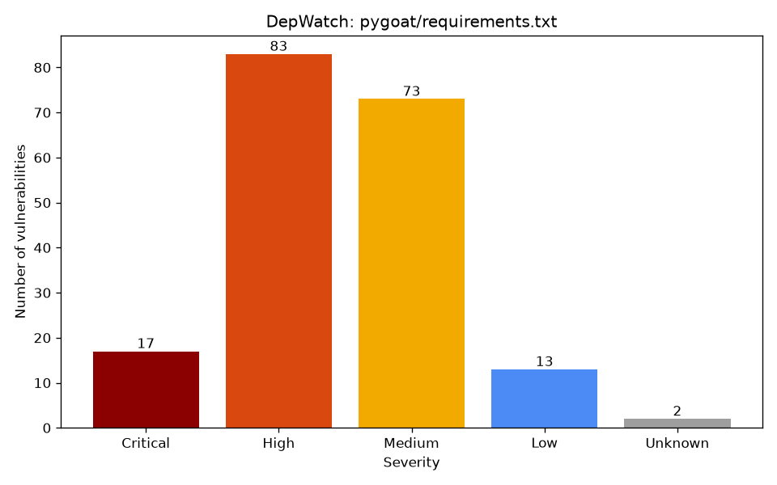

# DepWatch


DepWatch is a small Python command-line tool that reads a project's `requirements.txt`,
checks every exactly-pinned package against the free [OSV](https://osv.dev) vulnerability
database, ranks what it finds by severity, and saves a CSV/JSON report and a bar chart.

```
python -m depwatch scan requirements.txt
```

## Why it exists

Most of the code in a Python project comes from other people's packages. When one of those
packages has a published vulnerability (a CVE), the project inherits it. DepWatch answers three
questions quickly:

1. **Which of my pinned dependencies have known vulnerabilities?**
2. **Which ones should I fix first?** (ranked by severity, with the fixed version listed)
3. **What could not be checked, and why?** (unpinned packages, includes, URLs, failed requests)

The third question matters as much as the first two. A tool that silently skips a package, or
treats a failed network request as "no vulnerabilities", gives false confidence. DepWatch gives
every package exactly one status and says clearly when a scan is incomplete.

## Install

Requires Python 3.11 or newer.

```bash
git clone https://github.com/Semere-20/DepWatch.git
cd depwatch
python -m venv .venv
.venv\Scripts\activate          # Windows
# source .venv/bin/activate     # macOS / Linux
pip install -r requirements-dev.txt
```

Runtime dependencies: `requests`, `pandas`, `matplotlib`. Test dependencies: `pytest`, `pytest-cov`.
No API key is needed; OSV is free.

## Usage

```bash
python -m depwatch scan requirements.txt
python -m depwatch scan requirements.txt --fail-on critical --output-dir out/
python -m depwatch scan requirements.txt --format table --no-chart
python -m depwatch --version
```

| Option | Default | Meaning |
|---|---|---|
| `--output-dir DIR` | `reports/` | where `report.csv`, `report.json` and `chart.png` go |
| `--format table\|csv\|json\|all` | `all` | print a table, write CSV, write JSON, or all three |
| `--min-severity low\|medium\|high\|critical` | `low` | hide findings below this level in the table, files and chart. `Unknown` is always shown. Does **not** change the exit code. |
| `--fail-on low\|medium\|high\|critical\|none` | `high` | exit with code 1 if any finding is at or above this level |
| `--timeout SECONDS` | `10` | seconds to wait for each OSV request |
| `--no-chart` | off | do not create `chart.png` |

### Real output

This is the actual output of scanning NetBox's `requirements.txt`
(full log: [examples/netbox/run_log.txt](examples/netbox/run_log.txt); 44 of the 45 progress lines
cut here for length):

```
DepWatch 1.0.0: scanning examples/netbox/requirements.txt (45 entries)
  [1/45] colorama==0.4.6: no_known_vulns (OSV lists no known vulnerabilities for this version)
  ...
  [38/45] social-auth-core==5.2.0: vulnerable (1 known vulnerability)
  ...

                  package   version         status severity score             vuln_id fixed_versions                                                      summary
         social-auth-core     5.2.0     vulnerable   Medium   6.8 GHSA-h2r5-x5m7-3935          6.2.0 Python Social Auth: OpenID Connect nonce is not bound to ...

CSV saved: examples\netbox\report.csv
JSON saved: examples\netbox\report.json
Chart saved: examples\netbox\chart.png

Summary (45 packages/lines):
  vulnerable      1
  no_known_vulns  44
  unpinned        0
  skipped         0
  error           0
Findings by severity: Critical 0, High 0, Medium 1, Low 0, Unknown 0
Scan complete: all 45 pinned package(s) got an answer from OSV.
Exit code: 0
```

(Exit code 0 because the only finding is Medium and the default `--fail-on` is `high`.)

## How requirements.txt is read

Only an **exact pin** (`package==1.2.3`) counts as a version. DepWatch never guesses a version
and never looks at what is installed on your computer, because a guess could report the wrong
vulnerabilities, or miss real ones.

| Line in requirements.txt | Result |
|---|---|
| `requests==2.31.0` | scanned |
| `requests[security]==2.31.0` | scanned as `requests` (extras removed) |
| `tomli==2.0.1 ; python_version < "3.11"` | scanned (the marker is ignored) |
| `Django==4.2`, `my_pkg==1.0` | names normalized: `django`, `my-pkg` |
| `requests>=2.0`, `~=`, `<`, `!=`, `==2.*` | `unpinned`: not an exact pin |
| `requests` | `unpinned`: no version specified |
| `-r other.txt` / `-c constraints.txt` | `skipped`: scan that file separately |
| `-e .` / `-e git+https://...` | `skipped`: editable install |
| `git+https://...`, `pkg @ https://...` | `skipped`: URL / direct reference |
| `./libs/pkg`, `pkg-1.0-py3-none-any.whl` | `skipped`: local path / archive |
| `django 3.2`, `flask==` | `skipped`: could not parse this line |
| `django==3.2` and `Django==4.0` in one file | `skipped`: conflicting pins: 3.2, 4.0 |

Also handled: whole-line and inline comments (`# ...`), blank lines, a UTF-8 BOM, line
continuations (`\`) and `--hash=` options from pip-compile. The same package listed twice with the
same version is merged into one entry. If it is listed once pinned and once unpinned, the pinned
entry wins.

## Severity rules

Each vulnerability gets a level using the **first rule that applies**:

1. **`cvss_v3`**: the OSV record has a CVSS v3.x vector (for example
   `CVSS:3.1/AV:N/AC:L/PR:N/UI:N/S:U/C:H/I:H/A:H`). DepWatch calculates the base score itself
   ([depwatch/cvss.py](depwatch/cvss.py), the official v3.1 formula, no extra library) and maps it:

   | Score | Level |
   |---|---|
   | 9.0 – 10.0 | Critical |
   | 7.0 – 8.9 | High |
   | 4.0 – 6.9 | Medium |
   | 0.1 – 3.9 | Low |

   A score of 0.0 (no impact) has no level here, so it falls through to rule 2.
2. **`advisory_label`**: otherwise, use the advisory's own label (`database_specific.severity`).
   `CRITICAL`/`HIGH`/`LOW` map directly; GitHub's `MODERATE` maps to `Medium`.
3. **`none`**: otherwise the level is **Unknown**. Unknown findings are shown, ranked last,
   never dropped, and never hidden by `--min-severity`.

**Sort order:** level (Critical → Unknown), then score (highest first; no score goes last), then
package name. After the findings come the packages without findings, grouped by status.

The `severity_source` column in the report records which rule was used, so every rank can be
explained.

**Duplicate advisories:** OSV often returns the same flaw twice for a PyPI package (a `GHSA-…`
record from GitHub and a `PYSEC-…` record from the Python advisory database) that list each other
as aliases. DepWatch merges records that share an ID or alias into one finding, keeps the record
with the best severity data (CVSS first, then label, then none), and lists the other IDs in the
`aliases` column. In the real pygoat scan, OSV returned 97 records for `pillow==12.1.0`, which
merged into 60 distinct findings.

## Statuses and exit codes

Every package (or unscannable line) gets exactly one status:

| Status | Meaning |
|---|---|
| `vulnerable` | OSV answered and listed at least one vulnerability for this exact version |
| `no_known_vulns` | OSV answered and listed none. This means *none known*, not *safe*. |
| `unpinned` | no exact version, so not scanned |
| `skipped` | a line DepWatch does not scan (include, editable, URL, path, conflict, unparseable) |
| `error` | no trustworthy answer: timeout, connection error, HTTP 4xx/5xx, rate limit after retries, invalid JSON, or an unexpected response shape |

**"No vulnerabilities" is not the same as "scan failed".** A failed request always becomes
`error`, never `no_known_vulns`. HTTP 429 (rate limit) and 5xx responses are retried up to 3 times
with backoff (1 s, 2 s, 4 s, or the server's `Retry-After`, capped at 30 s). If any package
ends as `error`, the summary prints `SCAN INCOMPLETE`. If nothing at all was pinned (so OSV was
never asked), the summary prints a warning that this is not a clean result.

| Exit code | Meaning |
|---|---|
| `0` | scan finished and nothing at or above `--fail-on` |
| `1` | at least one finding at or above `--fail-on` |
| `2` | scan incomplete (any `error`) or bad input (missing/unreadable file, invalid arguments) |

Code 2 wins over code 1: if the scan is incomplete, the result is not trustworthy, whatever else
was found. `Unknown` findings never trigger `--fail-on` because their level is not known; they
still appear in the report.

## Example scans (real runs)

All five scans were run on 2026-11-08 with DepWatch 1.0.0 against the live OSV API. Each folder in
[examples/](examples/) holds the exact `requirements.txt` that was scanned, `report.csv`,
`report.json`, `chart.png` (only when there were findings to plot) and `run_log.txt` (command,
date, version, source repo, commit and the full output).

| Repo | Commit | Entries | vulnerable | no_known_vulns | unpinned | skipped | error | Findings (C / H / M / L / U) | Exit |
|---|---|---|---|---|---|---|---|---|---|
| [adeyosemanputra/pygoat](examples/pygoat/run_log.txt) | `2aa4cc1` | 32 | 15 | 17 | 0 | 0 | 0 | 188 (17 / 83 / 73 / 13 / 2) | 1 |
| [we45/Vulnerable-Flask-App](examples/Vulnerable-Flask-App/run_log.txt) (`app/requirements.txt`) | `b6a4f97` | 28 | 14 | 14 | 0 | 0 | 0 | 89 (6 / 39 / 39 / 4 / 1) | 1 |
| [home-assistant/core](examples/home-assistant-core/run_log.txt) | `c97172c` | 61 | 0 | 56 | 4 | 1 | 0 | 0 | 0 |
| [netbox-community/netbox](examples/netbox/run_log.txt) | `40e422c` | 45 | 1 | 44 | 0 | 0 | 0 | 1 (0 / 0 / 1 / 0 / 0) | 0 |
| [ansible/ansible](examples/ansible/run_log.txt) | `fd540ed` | 5 | 0 | 0 | 5 | 0 | 0 | 0 | 0 |

What the results show:

- **pygoat** and **Vulnerable-Flask-App** are deliberately vulnerable training apps with old pins,
  and DepWatch finds many issues (for example `django==4.2`: 51 findings, `tornado==4.5.1`: 23).
- **home-assistant/core** pins almost everything to recent versions: 56 packages checked, none with
  known vulnerabilities. Its `-c` constraints include and 4 range pins are listed, not silently ignored.
- **NetBox** has one Medium finding (`social-auth-core==5.2.0`, fixed in 6.2.0).
- **ansible** uses only ranges on purpose (its file says so in a comment), so DepWatch checks
  nothing and says so: *"WARNING: no package was checked against OSV ... This is not a clean result."*

Where the severity came from in the two large scans: pygoat 145 `cvss_v3`, 41 `advisory_label`,
2 `none`; Vulnerable-Flask-App 78 `cvss_v3`, 10 `advisory_label`, 1 `none`.

TheAlgorithms/Python was the original fifth repo, but it deleted its `requirements.txt` on
2025-10-15 (its dependencies moved to `pyproject.toml`, which DepWatch does not read), so NetBox
was scanned instead.



## Tests

```bash
python -m pytest -v --cov=depwatch --cov-report=term-missing
```

**176 tests pass. Line coverage is 99%** (569 statements, 3 missed). The 3 missed lines are
`depwatch/__main__.py`. It is tested by running `python -m depwatch --version` in a subprocess,
which coverage does not track. The latest run is in the
[GitHub Actions log](https://github.com/Semere-20/DepWatch/actions/workflows/tests.yml).

| Test file | Tests | Covers |
|---|---|---|
| `test_parser.py` | 52 | empty/missing/unreadable/non-UTF-8 files, comments, BOM, extras, markers, hashes, normalization, duplicates, conflicts, every unpinned and skipped case |
| `test_cvss.py` | 31 | known NVD scores (9.8, 10.0, 9.9, 7.8, 7.5, 6.1, 5.3, 3.1, 0.0), roundup, band boundaries, invalid vectors |
| `test_osv_client.py` | 24 | success, no vulns, timeout, connection error, HTTP 500/404, 429 then success, Retry-After, invalid JSON, wrong shapes, pagination |
| `test_severity.py` | 24 | each severity rule, fallbacks, fixed versions (including ignoring git commit hashes), alias merging, missing fields |
| `test_report.py` | 27 | sort order, empty report, chart skipped, filtering, status counts, summary wording, exit codes, CSV/JSON, scanner statuses |
| `test_cli.py` | 18 | defaults, every option, bad arguments, `--version`, `--help`, end-to-end flows with a fake OSV |

No test uses the network. The OSV client takes a `session` object, and tests pass a fake one
that returns prepared responses. CI ([.github/workflows/tests.yml](.github/workflows/tests.yml))
runs the suite on Python 3.11, 3.12 and 3.13 on every push and pull request.

## Project structure

```
depwatch/
  __init__.py      version number
  __main__.py      lets you run `python -m depwatch`
  cli.py           argparse options; runs parse -> scan -> report; returns the exit code
  parser.py        requirements.txt -> list of Requirement (pinned / unpinned / skipped)
  osv_client.py    POST to api.osv.dev with retries; every failure becomes OSVError
  cvss.py          CVSS v3.x base-score calculator and score -> level bands
  severity.py      the three severity rules, fixed versions, alias merging
  scanner.py       runs every requirement through OSV; one status per package
  report.py        pandas table, sorting, summary, CSV/JSON, chart, exit code
tests/             pytest suite (mocked, no network)
examples/          real scans of 5 public repos
.github/workflows/ CI: runs the tests on every push and pull request
```

## Limitations

- **Exact pins only.** Ranges and bare names are reported, not scanned. Transitive dependencies
  (packages your packages install) are only scanned if they are pinned in the same file.
- **Only `requirements.txt` format.** No `pyproject.toml`, `poetry.lock`, `Pipfile.lock` or
  `uv.lock`. `-r` and `-c` includes are listed but not followed.
- **CVSS v3 only.** Records with only a CVSS v4 (or v2) vector fall back to the advisory label.
- **"No known vulnerabilities" means none known to OSV today.** It does not mean the package is safe.
- **One request per package, one at a time.** Fine for tens of packages; slow for thousands.
- **Environment markers are ignored.** A package marked for Python < 3.10 is still scanned.
- **Base score only.** It does not consider whether your code actually calls the vulnerable function,
  or exploit activity (temporal/environmental CVSS, EPSS, CISA KEV).

## Future ideas

- Use OSV's `/v1/querybatch` endpoint to check many packages in one request.
- Follow `-r` includes, and read `pyproject.toml` and lock files.
- A CVSS v4 calculator.
- Add EPSS / CISA KEV data to rank by "likely to be exploited", not only by severity.
- Cache OSV answers for a short time so repeat scans are faster.
- A `--fix` suggestion that prints the smallest upgrade that clears all findings.
